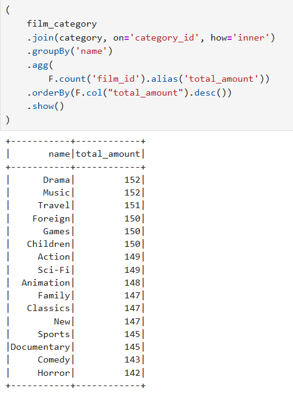
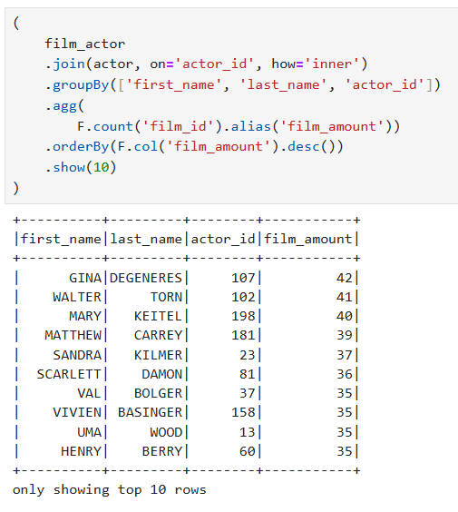
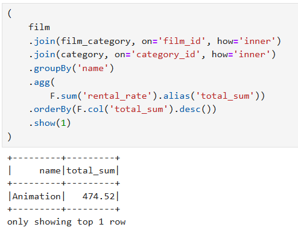
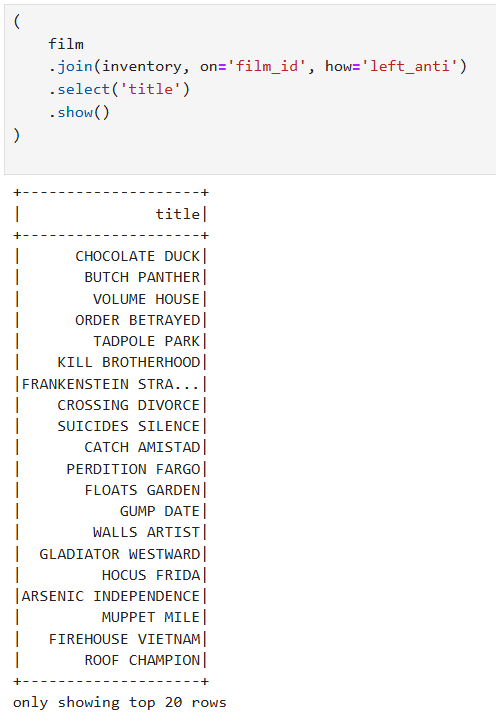
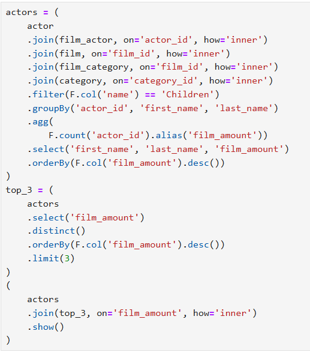
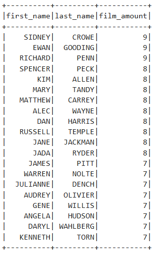
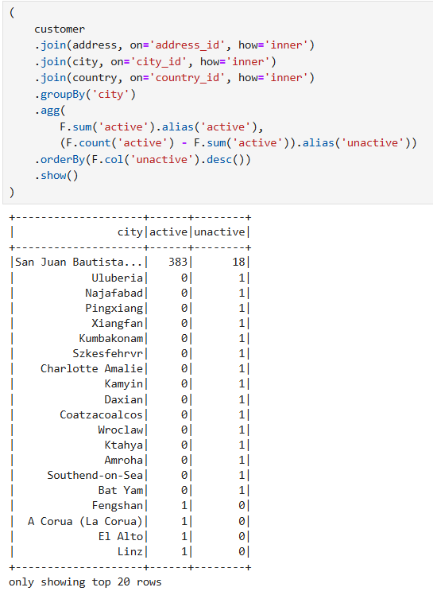
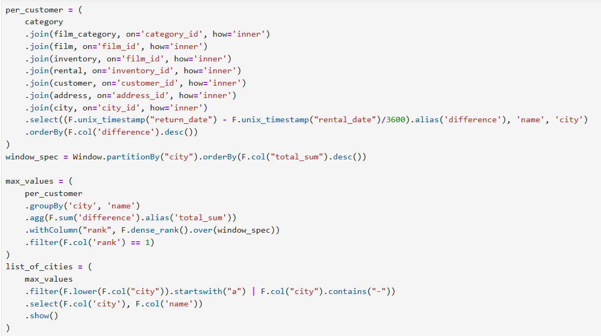
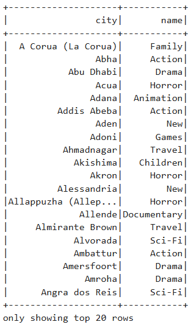

# Spark_task_1

Output the number of movies in each category, sorted in descending order. 

Output the 10 actors whose movies rented the most, sorted in descending order. 

Output the category of movies on which the most money was spent. 

Output the names of movies that are not in the inventory.

Output the top 3 actors who have appeared most in movies in the “Children” category. If several actors have the same number of movies, output all of them. 

Output cities with the number of active and inactive customers (active - customer.active = 1). Sort by the number of inactive customers in descending order. 

Output the category of movies that have the highest number of total rental hours in the cities (customer.address_id in this city), and that start with the letter “a”. Do the same for cities with a “-” symbol.

